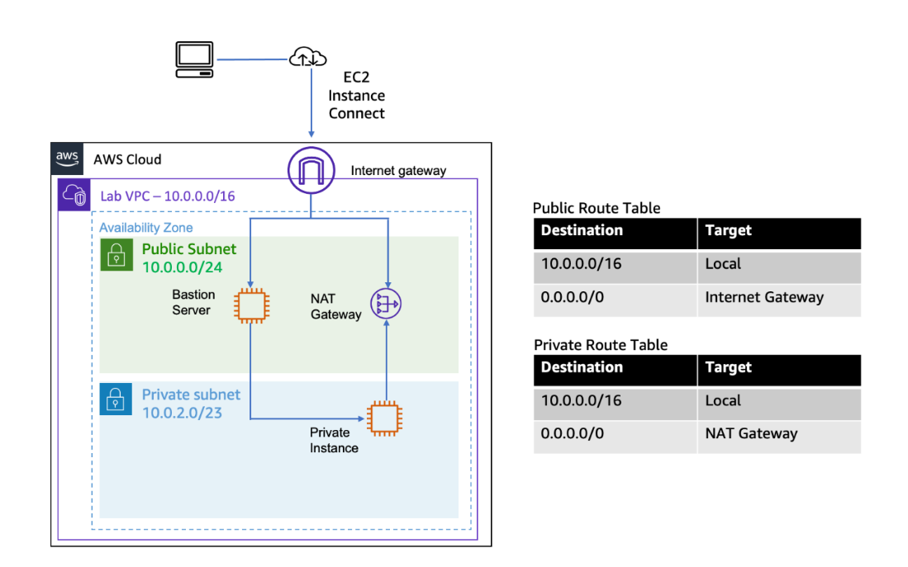
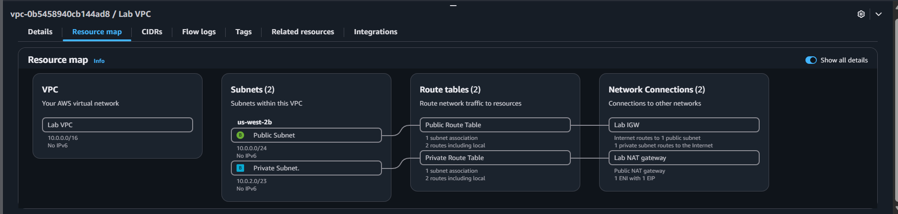
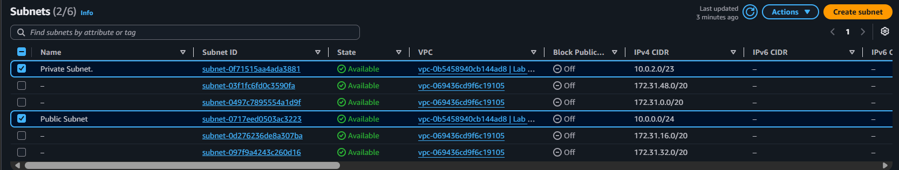
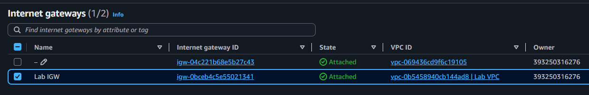
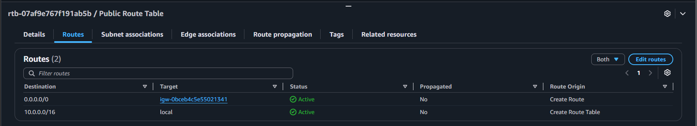
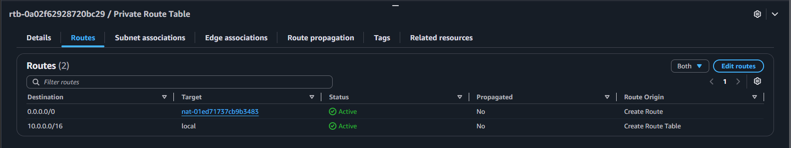
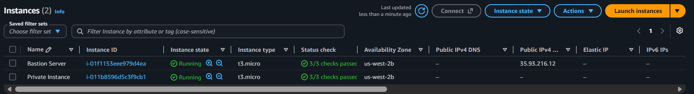
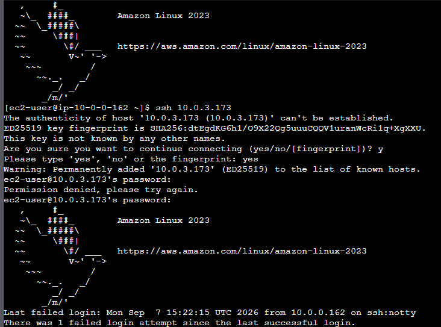
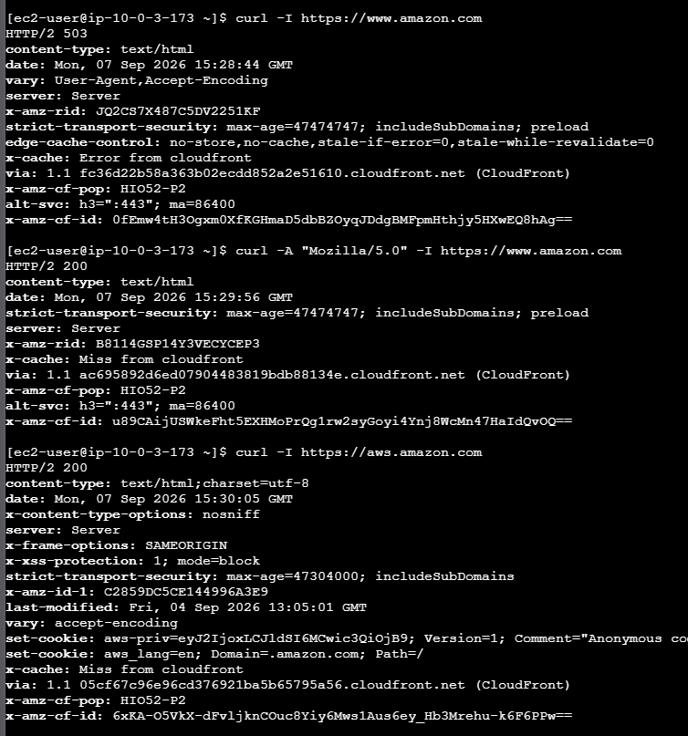

# AWS VPC Custom Architecture: Multi-Tier Network with Bastion Host & NAT Gateway

##  Project Overview
Project ini bertujuan untuk merancang dan mengimplementasikan arsitektur **Amazon Virtual Private Cloud (AWS VPC)** custom secara aman. Infrastruktur ini mengisolasi resource sensitif (seperti server aplikasi/database) di **Private Subnet**, sementara akses manajemen lalu lintas masuk dilakukan melalui **Bastion Host (Jump Box)** di **Public Subnet**, dan koneksi internet keluar (outbound) diatur secara aman melalui **NAT Gateway**.

---

##  Infrastructure Architecture Diagram

---

##  Network & Infrastructure Specifications

### 1. VPC & Subnet Design
| Resource Name | Subnet Type | CIDR Block | Availability Zone | Internet Access |
| :--- | :--- | :--- | :--- | :--- |
| **Lab VPC** | Custom VPC | `10.0.0.0/16` | Multi-AZ | Via IGW & NAT Gateway |
| **Public Subnet** | Public | `10.0.0.0/24` | AZ-1 | Direct (Auto-assign Public IP) |
| **Private Subnet**| Private | `10.0.2.0/23` | AZ-1 | Outbound Only (via NAT Gateway) |

### 2. Routing & Gateways
| Route Table | Destination | Target | Subnet Association |
| :--- | :--- | :--- | :--- |
| **Public Route Table** | `0.0.0.0/0` | `Lab IGW` (Internet Gateway) | Public Subnet |
| **Private Route Table** | `0.0.0.0/0` | `Lab NAT gateway` (NAT GW) | Private Subnet |

### 3. Compute Instances & Security Groups
| Instance Name | Subnet | Public IP | Inbound Rules | Role |
| :--- | :--- | :--- | :--- | :--- |
| **Bastion Server** | Public Subnet | Enabled | SSH (`22`) from Anywhere (`0.0.0.0/0`) | Jump Host / Management |
| **Private Instance** | Private Subnet | Disabled | SSH (`22`) from VPC CIDR (`10.0.0.0/16`) | Isolated Internal Server |

---

##  Implementation Screenshots & Evidence

### 1. AWS VPC Resource Map
Visualisasi topologi VPC AWS yang memperlihatkan hubungan otomatis antara Subnet, Route Table, Internet Gateway, dan NAT Gateway.

### 2. Subnets Configuration
Konfigurasi alokasi IP CIDR untuk Public Subnet dan Private Subnet.

### 3. Gateways Status (IGW & NAT Gateway)
* **Internet Gateway:** Terhubung (*Attached*) ke `Lab VPC` untuk menangani lalu lintas publik.
* **NAT Gateway:** Ditempatkan di Public Subnet dengan *Elastic IP* teralokasi untuk menangani *outbound traffic* dari Private Subnet.

### 4. Route Tables Setup
Aturan *routing table* untuk lalu lintas publik (`IGW`) dan private (`NAT Gateway`).

### 5. EC2 Instances Status
Daftar instance EC2 yang menunjukkan `Bastion Server` memiliki Public IP, sedangkan `Private Instance` hanya memiliki Private IP.

---

##  Proof of Concept (Verification & Testing)

Pengujian end-to-end dilakukan melalui terminal dengan alur sebagai berikut:
1. SSH / EC2 Instance Connect ke **Bastion Server** (Public Subnet).
2. Melakukan SSH Jump dari Bastion Server ke **Private Instance** (`ssh 10.0.2.x`).
3. Menjalankan perintah `ping -c 3 amazon.com` dari Private Instance. Hasil respon ICMP membuktikan bahwa Private Instance **berhasil mengakses internet keluar secara aman melalui NAT Gateway** tanpa terekspos ke publik.

---

## Summary Deployment Steps

1. **VPC & Subnets Provisioning:**
   * Buat VPC `10.0.0.0/16` dan aktifkan *DNS hostnames*.
   * Buat Public Subnet (`10.0.0.0/24`) & Private Subnet (`10.0.2.0/23`).
   * Aktifkan *Auto-assign Public IP* pada Public Subnet.

2. **Gateways & Routing Setup:**
   * Buat & attach Internet Gateway ke VPC.
   * Buat Elastic IP & NAT Gateway di Public Subnet.
   * Konfigurasi Public Route Table (`0.0.0.0/0` -> IGW) dan Private Route Table (`0.0.0.0/0` -> NAT GW).

3. **Compute Deployment & Testing:**
   * Deloy `Bastion Server` di Public Subnet.
   * Deploy `Private Instance` di Private Subnet.
   * Uji koneksi SSH Jump Host dan cek outbound ping dari Private Instance.

---

##  Cleanup Instructions
Untuk menghindari biaya tambahan pada akun AWS:
1. Terminate seluruh EC2 Instances (`Bastion Server` & `Private Instance`).
2. Delete NAT Gateway dan Release Elastic IP.
3. Detach & Delete Internet Gateway.
4. Delete Subnets & VPC.
